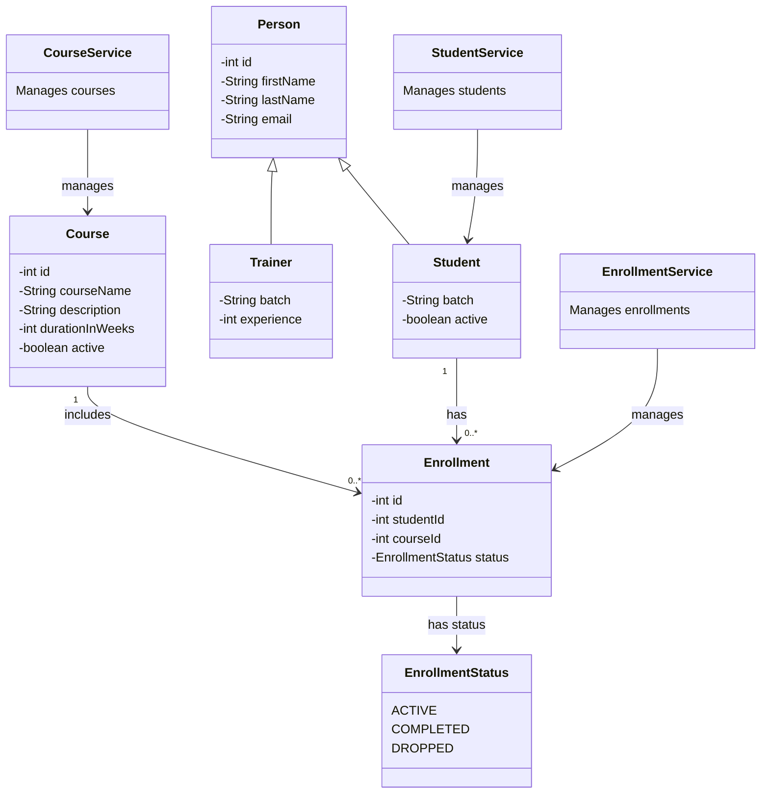

# LearnTrack

LearnTrack is a console-based student, course, and enrollment management system written in Core Java.

## Features

The console menus currently support:

- Adding, listing, searching, and deactivating students
- Adding, listing, and deactivating courses
- Creating enrollments and viewing enrollments for a student
- Marking an enrollment as completed

All data is stored in memory. Students, courses, enrollments, and generated IDs are lost when the application exits.

## Project structure

- `src/com/practice/learntrack/entity`: domain models such as `Student`, `Course`, `Enrollment`, `Person`, and `Trainer`
- `src/com/practice/learntrack/service`: in-memory services for students, courses, and enrollments
- `src/com/practice/learntrack/ui/Main.java`: console entry point and menu flow
- `src/com/practice/learntrack/util/IdGenerator.java`: shared in-memory ID counters
- `src/com/practice/learntrack/exception`: application-specific exceptions

## How to compile and run
Use compatible JDK and compile from the project root (com.practice.learntrack.ui.Main.java).

## Class diagram

The diagram shows the main classes and how students, courses, and enrollments
work together.